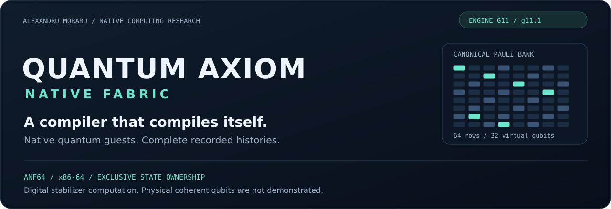
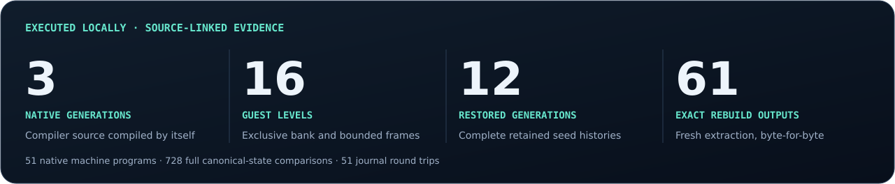
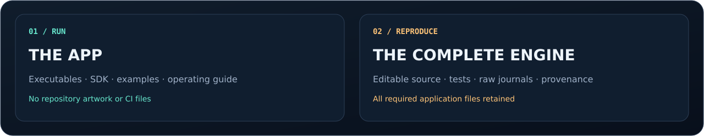
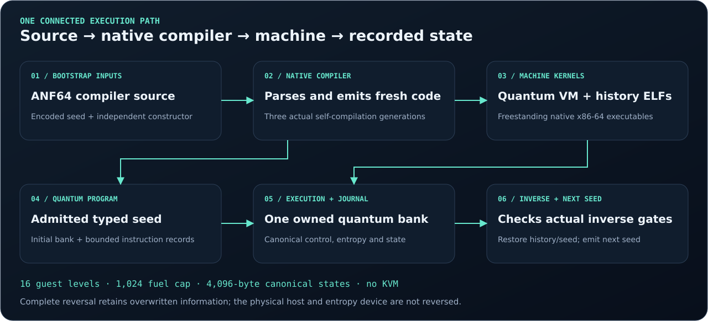

# Quantum AXIOM

A self-hosted native compiler and a machine-defined quantum runtime for Linux x86-64. The compiler builds its own ANF64 source into executable machine code. The runtime owns a 32-qubit digital stabilizer bank, bounded guest frames and a complete reversible journal.

**Engine G11 · Distribution g11.1 · Alexandru Moraru**

[Download the app](https://github.com/fireside25a-beep/Quantum-AXIOM/releases/latest/download/axiom-g11.1-linux-x86_64.zip) · [Download complete source and evidence](https://github.com/fireside25a-beep/Quantum-AXIOM/releases/latest/download/axiom-g11.1-complete.zip) · [Read the operating guide](docs/GETTING_STARTED.md) · [Inspect the evidence](application/evidence/VERIFICATION_SUMMARY.json)

The release links become available when the prepared `g11.1` tag is published. Until then, `make package` produces the same two package layouts locally in `dist/`.



## Choose a download



| Download | Includes | Use it to |
|---|---|---|
| `axiom-g11.1-linux-x86_64.zip` | Native executables, launcher, SDK libraries and headers, examples, compiler seed/source, operating manual and checksum inventory | Run, compile, self-compile and reverse recorded machine histories |
| `axiom-g11.1-complete.zip` | The whole project tree: application source, tests, evidence, maintainer tools, README artwork, workflows and documentation | Rebuild, reproduce, audit and maintain the implementation |

The Linux app ZIP excludes repository presentation and maintainer tooling. The complete ZIP and Git source archives include the reviewed project tree, including this README, SVGs and workflows. See [the package contract](docs/DISTRIBUTION.md).

## Run the app

Extract the Linux package and enter its top directory:

```sh
bash VERIFY.sh
./bin/axiom doctor
./bin/axiom demo
./bin/axiom selfhost
```

The app is relocatable. Native compile/run/history operations need no Python, assembler or third-party quantum SDK. The operating-system target is Linux x86-64. The shipped dense tools require glibc 2.41 or newer; examples using `qentropy` require CPU RDSEED. The [operating guide](docs/GETTING_STARTED.md) covers direct commands and refusals.

## How the machine connects



The independent initial constructor establishes a transparent bootstrap. Native compiler generations then parse and compile the compiler's own source. The same native compiler builds the quantum machine and history tool. Guest code uses an admitted quantum ISA with checked program counters, ownership, code views, fuel and returns; parent execution suspends while a child owns the single quantum bank.

The journal records every canonical state and the original seed. Native inverse quantum kernels check predecessor states. The retained control and entropy preimages permit complete recorded-history restoration. The next-seed path carries the executed final quantum bank and actual hardware-entropy word forward.

| Profile | Execution | Scope |
|---|---|---|
| ANF64 | Freestanding x86-64 compiler | Native source self-compilation and typed quantum seeds |
| Native machine | 32 virtual stabilizer qubits | Exact Pauli algebra, bounded nested guests and recorded-history reversal |
| Direct Clifford | Expanded H/S/CX machine instructions | Legacy compatibility and triplicated classical state correction |
| Dense QVU1 | Up to 20 virtual qubits with Q30 amplitudes | Non-Clifford gates, measurement, reset, replay and classical feedback |

## Verification you can inspect

The current [execution summary](application/evidence/VERIFICATION_SUMMARY.json) records 51 native machine programs, 728 full canonical-state comparisons, 51 journal round trips and the maximum tested guest depth of 16. Source-level changed-compiler behavior, 100 independent instruction-encoding comparisons and unseen native programs test self-hosting beyond simple image copying.

The [fresh-extraction report](application/evidence/standalone_extraction.json) confirms all 61 generated outputs rebuild byte-for-byte and a fresh twelve-generation entropy chain restores. Raw journals, negative tests, complete source identities and the original reference notices are included.

```sh
# In a separate working copy; rebuilding changes the signed snapshot.
make test
make check
```

## Scientific and security scope

These are digital quantum-state representations executed by classical CPUs. Physical coherent qubits and quantum advantage are not demonstrated. Complete reversal requires retained canonical history; it does not reverse host time or the physical entropy device. The dense non-Clifford engine is a separate numerical profile.

The supplied SNN state comes from a controlled execution of preserved reference source. It is not established as the exact latest previously saved trained/live checkpoint. Windows and ARM64 execution remain untested. The reference sanitizer run retains an explicit LeakSanitizer/host-tracing blocker. No KVM or HX89 source is used.

Read the [scope audit](application/docs/RELEASE_COMPLETENESS_AUDIT.md), [machine ABI](application/docs/MACHINE_ABI.md), [ANF64 language](application/docs/ANF64.md) and [security model](application/security/SECURITY_MODEL.md).

## Repository map

| Location | Responsibility |
|---|---|
| `application/` | The complete standalone G11 engine, editable sources, binaries, examples and research evidence |
| `presentation/` | Source-generated SVG panels for this README |
| `maintainer/` | Deterministic packaging, delivery checks and existing-repository publishing preflight |
| `.github/workflows/` | Verification and tag-triggered release asset publishing |
| `docs/` | Operating guide, download policy and maintainer release procedure |

Copyright Alexandru Moraru. First-party code and release materials are published under [Apache License 2.0](LICENSE); [licensing scope](LICENSING.md) explains the preserved signed application's older notice. The selected historical reference retains its own Apache license and notices under `application/tests/reference/closed_routine/`.
