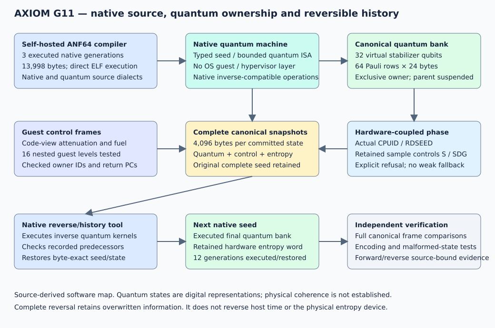

# AXIOM Native Fabric

G11 adds a self-hosted native compiler, a machine-defined quantum VM, and complete recorded seed-history reversal. The compiler, quantum machine and reverse tool are freestanding x86-64 ELF executables built from editable ANF64 source. No external language runtime, hypervisor, OS guest or namespace mechanism executes the quantum guests.

The machine owns a canonical 32-qubit stabilizer tableau, program counter, code-view bounds, guest ownership, fuel, entropy word and guest frames. Guest nesting is checked inside this machine. Parent execution suspends while its quantum bank is lent to a child; the bank is not duplicated for a call.

## Run the native chain

From the extracted root on Linux x86-64:

```sh
./native/selfhost/anf_stage3.x86_64 < examples/Machine/nested_quantum.anf > /tmp/axiom.seed
./native/machine/quantum_machine.x86_64 < /tmp/axiom.seed > /tmp/axiom.history
./native/machine/reverse_history.x86_64 < /tmp/axiom.history > /tmp/axiom.reverse.history
./native/machine/reverse_history.x86_64 seed < /tmp/axiom.reverse.history > /tmp/axiom.restored.seed
cmp /tmp/axiom.seed /tmp/axiom.restored.seed
```

Generate the next seed from the actual final quantum state and recorded hardware-entropy word:

```sh
./native/machine/reverse_history.x86_64 next < /tmp/axiom.history > /tmp/axiom.next.seed
./native/machine/quantum_machine.x86_64 < /tmp/axiom.next.seed > /tmp/axiom.next.history
```

The `qentropy` instruction requires CPUID-reported RDSEED and fails explicitly if the hardware sample is unavailable. It has no software-random fallback. `qephase` applies a phase selected by the retained entropy word. The journal retains overwritten information so the complete canonical seed/control/quantum history can be restored exactly.

## Genuine native self-hosting

`native/selfhost/compiler.anf` is written in the same ANF64 language accepted by its compiled executable. The compiler parses labels, symbols, instructions, operands and quantum-program directives, performs two passes, and generates new ELF images or typed quantum seeds. It does not reconstruct its output by copying its own image.

```sh
./native/seed/native_seed_emitter.x86_64 < native/selfhost/compiler_seed.bits > /tmp/axiom.compiler
chmod 700 /tmp/axiom.compiler
/tmp/axiom.compiler < native/selfhost/compiler.anf > /tmp/axiom.compiler.next
cmp /tmp/axiom.compiler /tmp/axiom.compiler.next
```

Three executed native source-compilation generations are included. The independent Python stage-zero constructor is retained for reproducible bootstrap provenance and differential checking. The native seed-to-compiler-to-source-compilation path above does not invoke Python or a system assembler.

## Execution profiles

| Component | Actual behavior |
|---|---|
| ANF64 native/quantum compiler | Compiles its own source, native x86-64 programs and quantum seed programs |
| Native quantum machine | Exact 32-qubit stabilizer operations, entropy-conditioned phases, bounded nested quantum guests |
| Native history tool | Checks inverse quantum transitions, reverses the complete retained history, restores seeds and emits next seeds |
| Legacy direct Clifford images | Expanded native H/S/CX instruction images with triplicated state correction |
| Legacy dense QVU1 engine | Up to 20 virtual qubits, Q30 amplitudes, non-Clifford T/TDG, measurement, reset and feed-forward |
| Source-linked compatibility reference | Minimal preserved SNN/quantum sources, actual feedback/correction execution and imported-state checks |

The machine's qubits are an exact digital stabilizer-state representation. The dense profile calculates digital amplitudes. These executed semantics establish software quantum computation; this release does not demonstrate physically coherent qubits or quantum advantage. Dense non-Clifford execution remains a separate profile, with measured fixed-point error. The new native history/nesting protocol applies to the 32-qubit machine profile.



## Evidence and limits

`evidence/native_self_hosting.json` and `evidence/native_machine_acceptance.json` bind the actual native compiler generations, source changes, differential encodings, quantum operations, nested execution, inverse checks and cross-generation restoration. Raw forward/reverse journals and twelve generation histories are included. `evidence/VERIFICATION_SUMMARY.json` records the current measured counts and toolchain.

The quantum VM permits at most 1,024 records/committed transitions per seed and 16 nested guests. Complete reversal requires its retained journal. Reversing a journal does not reverse the physical entropy source or host time. The reference C sanitizer process has an explicitly recorded LeakSanitizer/host-tracing blocker; it is not reported as a complete sanitizer pass. Windows and ARM64 execution remain untested.

## Build and verify

On a separate working extraction:

```sh
make all
bash scripts/RUN_VERIFICATION.sh
```

Requirements are listed in [DEPENDENCIES.md](docs/DEPENDENCIES.md). The production machine path is native ANF64 source and direct machine instructions; C is used only by the historical compatibility reference and SDK consumer test. The legacy dense tools use libc for I/O and allocation.

For the pristine distributed snapshot:

```sh
bash security/VERIFY_RELEASE.sh
```

Rebuilding writes evidence and changes the signed snapshot. Source-only clean reconstruction and distribution-tamper tests are provided.

| Directory | Contents |
|---|---|
| `native/selfhost/` | Compiler source, explicit stage-zero constructor, encoded compiler seed, three native self-compilation generations |
| `native/machine/` | Shared quantum kernel, native machine/history sources, executables and public ABI constants |
| `native/seed/`, `native/clifford/`, `native/dense/` | Preserved compatible execution components, source, binaries and validation SDK |
| `examples/` | Native-machine sources/seeds, state-transfer examples and dense quantum programs |
| `tests/` | Native/differential/adversarial acceptance and the minimal active source reference |
| `evidence/` | Raw journals, generation chains, logs, source/build/fault/oracle results |
| `docs/`, `ai/`, `security/` | ABI, scope, source identities, architecture, signed inventory and verification |

See [MACHINE_ABI.md](docs/MACHINE_ABI.md), [ANF64.md](docs/ANF64.md), and [the current scope audit](docs/RELEASE_COMPLETENESS_AUDIT.md). HX89 informed only the architectural request; no HX89 code is included or reused.

Copyright Alexandru Moraru. See [LICENSE](LICENSE) and the preserved reference notices.
